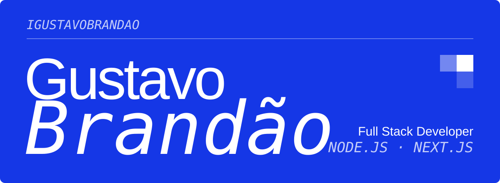
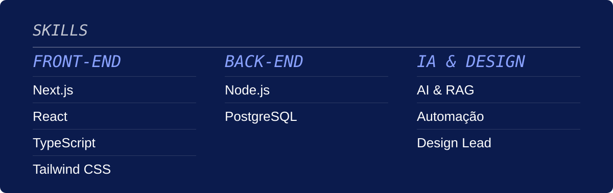
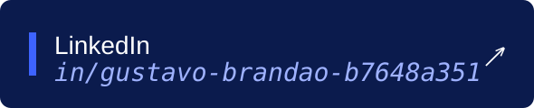

## Sobre Mim

Desenvolvedor Full Stack trabalhando com **Next.js**, **Node.js** e **PostgreSQL**. Experiência com integração de IA usando **LangChain**, **RAG**, **embeddings** e bancos vetoriais. Design systems e componentes reutilizáveis.

## Experiência Profissional

### Olho no Leilão
**Desenvolvedor Frontend**

Responsável por melhorias na arquitetura de UI utilizando:
- **Componentes reutilizáveis**: Estruturação de bibliotecas de componentes com padrões de design consistentes
- **Tokens CSS**: Implementação de sistemas de tokens para cores, tipografia, spacing e breakpoints
- **Componentização**: Refatoração de código em componentes menores e mais manuteníveis
- **Padrões de design**: Aplicação de design systems para garantir coesão visual em toda a aplicação

**Link:** https://olhonoleilao.com/

---

### Syncabyte Finance
**Desenvolvedor Frontend**

Desenvolvimento e otimização da plataforma de finanças com foco em:
- **Arquitetura de componentes**: Estruturação escalável de UI com React/TypeScript
- **Tokens CSS**: Sistema de design tokens para consistência visual e facilitação de manutenção
- **Performance**: Otimização de renderização e carregamento de componentes
- **Responsividade**: Implementação de interfaces adaptáveis para múltiplos dispositivos

**Link:** https://finance.syncabyte.com/

---

### Mutual Capital
**Design Lead, Desenvolvedor Frontend & AI Engineer**

Liderança na prototipagem de produtos e no desenvolvimento frontend, com foco na criação de interfaces e na automação de conteúdo:
- **Prototipagem**: Design e validação de protótipos para novas funcionalidades
- **Design System**: Criação e evolução de um sistema de design com componentes reutilizáveis
- **Componentes**: Implementação de interfaces com TypeScript e Tailwind CSS, com foco em usabilidade
- **Automação de conteúdo**: Criação de um sistema que coletava notícias relevantes para o mercado cripto e gerava podcasts com IA, newsletters e análises técnicas semanais das criptomoedas
- **Distribuição**: Envio automatizado dos conteúdos aos assinantes por e-mail e WhatsApp
- **Agente de IA**: Desenvolvimento de uma harness integrada a um agente de IA para controlar todo o fluxo pelo WhatsApp

**Link:** https://mutualcapital.com.br/

---

### IAjur Office
**Desenvolvedor Full Stack & AI Engineer**

Desenvolvimento de um sistema jurídico para o professor [@prof.jayltonlopes](https://www.instagram.com/prof.jayltonlopes/), referência no direito brasileiro. Foi um dos meus primeiros projetos com aplicações de IA e busca semântica:
- **IA e busca semântica**: Uso de LangChain e embeddings para consultar conteúdos jurídicos
- **Qualidade da busca**: Aplicação de estratégias para melhorar a relevância dos resultados, incluindo a adição de sumários aos materiais durante a ingestão
- **Newsletter jurídica**: Criação de uma newsletter que busca notícias relevantes sobre inventário, herança e temas relacionados ao direito sucessório

---

### MonkeyPay
**Desenvolvedor Full Stack Junior**

Desenvolvimento full stack com ênfase em melhorias de UI/UX:
- **UI/UX Improvements**: Redesign e otimização de interfaces focando em usabilidade e acessibilidade
- **Componentes reutilizáveis**: Criação de biblioteca de componentes padronizados
- **Tokens CSS**: Implementação de sistema de tokens para manutenção facilitada
- **Bug Fixes**: Correção de issues críticas e melhorias de performance
- **Design tokens**: Uso de variáveis de design para escalabilidade

**Link:** https://monkeypay.app/

---

  
  

